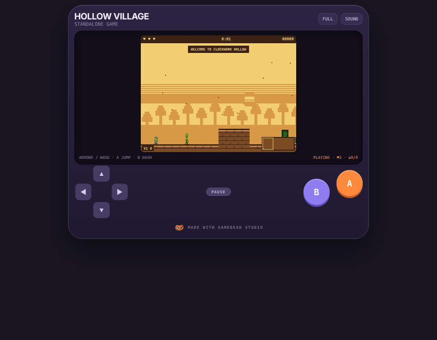
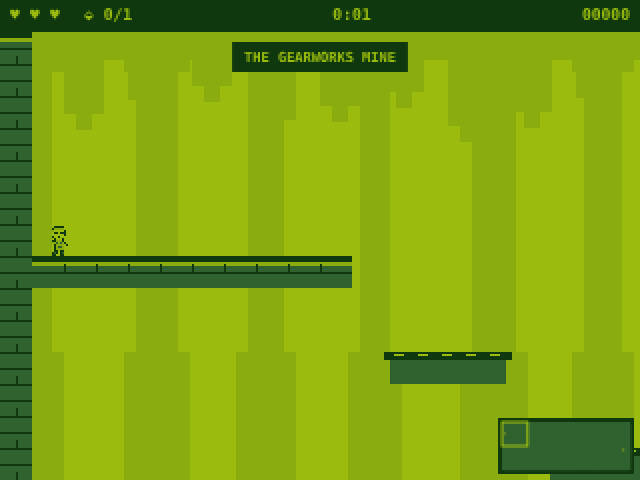
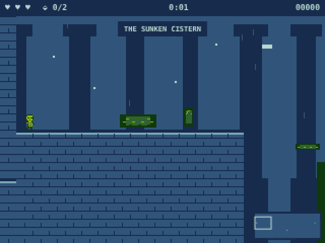
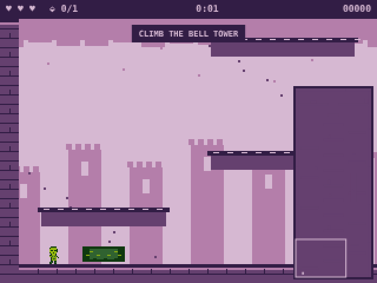
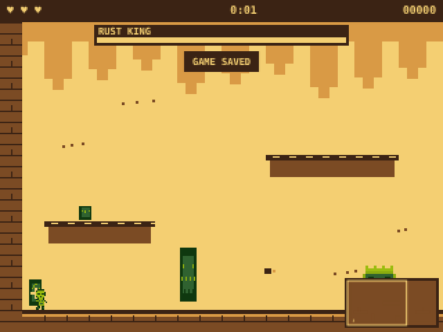

# Clockwork Hollow

A five-scene adventure platformer made with [GameBean Studio](https://github.com/icakinser/gamebean-studio), built entirely through the AI Builder chat: seven messages, no hand-placed objects.

**Play:** open `index.html` in any browser (phone too). **Edit:** GameBean Studio > FILE > Open… > Browse this computer… > `clockwork-hollow-cartridge.json`.

**Tested by the whole-game bot:** GameBean's test bot plays it from the village to the Rust King's forge, collecting all three cogs on the way. It found two bugs (the Cog Gate could be jumped with two cogs, and ringing the bell again brought a cog back), and both are fixed in this version.

The full chat, every tool call the AI made and every result, is in [Chat transcript.md](Chat%20transcript.md).

## The game in one paragraph

You are a goggled clockwork kid in Hollow Village. The Old Clockmaker says the village clock has lost three cogs. Three doors lead to three areas: the **Gearworks Mine**, the **Sunken Cistern** and the **Bell Tower**. Each one hides a cog and teaches you a new move (Dash in the mine, Double Jump in the cistern). With all three cogs, the **Cog Gate** opens, and you face the **Rust King** in his forge.

| Scene | Size | What's there |
|---|---|---|
| Hollow Village (start) | 3 screens wide | Clockmaker, 3 area doors, save clock, tinker stall, hidden heart, Cog Gate |
| Gearworks Mine | 5 x 2 screens | crumbling beams over spikes, ladder to a lower tunnel, Brass Key and Door, Dash shrine, cracked wall, Mine Cog |
| Sunken Cistern | 4 x 2 screens | flooded basin with a current and eels, raft, cracked wall, floor switch and water gate, Double Jump shrine, Cistern Cog |
| Bell Tower | 1.5 x 5 screens | 75-tile climb, bats, drone, fire bar, updraft, belfry you need Double Jump for, bell that drops the Tower Cog |
| Rust King's Forge (last) | 1 screen | boss arena, boss music and camera shake on entry, the Rust King with a health bar and 3 phases |

## Part 1: Build it yourself with the AI Builder

### Before you start

1. Open GameBean Studio.
2. In the top bar, click **New**. In the NEW GAME window, pick **EMPTY GAME**.
3. In the top bar, under **Create**, click **AI Builder**. The AI Builder panel opens on the right.
4. If it asks for an API key, click the gear (**AI settings**), choose a provider, paste your key into **API KEY**, and pick a **MODEL**. A run like this costs roughly $1-5 with a good model.
5. Make sure the **BUILD** button at the top of the panel is selected, not **ASK**. BUILD lets the AI change the game. ASK only answers questions.

### How each step works

For each message below:

1. Click in the message box at the bottom of the panel (it says *"Make the bats faster and add a checkpoint…"*).
2. Paste the message and press **Enter**.
3. Wait. The panel shows *"step N of 40"* and the cost so far. The AI places objects, test-plays the level with its bot, and fixes what the bot finds.
4. When it finishes, read its reply, then press **Play** and try the new part.
5. If you like it, click **KEEP**. If not, click **UNDO ALL** and send the message again, maybe reworded.

Send the messages in order, one at a time. Each message builds on the last.

### Message 1: the village and the level list

> Make me a big new adventure platformer called Clockwork Hollow. You start in a village hub and talk to an old clockmaker. Three doors lead to three areas: the Gearworks mine, the Sunken Cistern and the Bell Tower. Each area hides a cog. Bring all 3 cogs back to open the gate to the boss, the Rust King. Start with the hub and the level layout, I'll ask for each area after.

**What you get:** five scenes in the level list, the full village, the Old Clockmaker, three doors with arrival spots for coming back, a save clock, signs, a hidden heart container, and the Cog Gate. Variable 1 counts cogs and shows in the corner of the screen. The gate opens when it reaches 3.

### Message 2: the Gearworks Mine

> Great! Now build the Gearworks Mine. Make it a proper level: crumbling beams over a spike pit, a lower tunnel with a key, a locked door, the Dash shrine, enemies, checkpoints, and the cog behind a cracked wall at the end. Taking the cog should bring me back to the village.

**What you get:** rust mites, a gear hound, a swooping bat, rotten beams that crumble under you, three checkpoint lamps, a sliding saw and a falling rock. A ladder leads down to the lower tunnel, where the Brass Key waits at the far left. The key opens the Brass Door, Dash smashes the Cracked Wall, and the Mine Cog adds 1 to the counter.

### Message 3: the Sunken Cistern

> Love it. Next the Sunken Cistern: a big flooded basin to swim through with eels and a current, a raft, then a cracked wall you need the dash for, a floor switch that opens a water gate, the Double Jump shrine and the second cog. Exit back to the village.

**What you get:** a stone ledge, then a deep basin with a gentle current pushing back, two hunting eels, a cork raft, a pearl and a sunken heart. On the far side you dash through a cracked wall, step on the Sluice Switch to open the Water Gate, and touch the Double Jump shrine before taking the Cistern Cog.

### Message 4: the Bell Tower

> Now the Bell Tower: a tall climb up ledges with bats, a fire bar, an updraft and checkpoints. At the top you need the double jump to get into the belfry, and ringing the bell drops the third cog. Exit home after.

**What you get:** 20 zigzag ledges, a blinking ledge, two bats, a brass drone that shoots, a fire bar, a chimney updraft up the right side, and three checkpoint lamps. Ring the Great Bell three times and the hidden Tower Cog appears.

### Message 5: the Rust King's Forge

> Last area: the Rust King's Forge. A one-screen boss arena with ledges, boss music and a camera shake when you walk in, and the Rust King himself with a health bar and phases. Beating him wins the whole game.

**What you get:** a one-screen arena with three ledges, a save statue, two hearts, and a tripwire that shakes the camera and starts the boss music. The Rust King is a 32x32 hand-drawn robot with 8 health, three phases that speed him up, a health bar and aimed rust shots.

### Message 6: play-test fixes and sprites

Play the game from the start. In our run, the bell did nothing, so we sent:

> I played it. In the Bell Tower, ringing the bell 3 times doesn't drop the cog, so I'm stuck. Can you fix that? Also give the hero and the old clockmaker real sprites, and have the clockmaker tell me how many cogs I have so far.

**What you get:** a working bell, a goggled clockwork-kid sprite for the hero with a walking frame, a bearded clockmaker, and a clockmaker line that says **COGS FOUND: 2 OF 3** using your real count. (The bell bug itself is now fixed in GameBean, so your copy may not need this part.)

### Message 7: the real ending

In our run, beating the Rust King went on to the cistern, so we sent:

> I beat the Rust King but it sent me to the Sunken Cistern instead of ending the game. Please make beating him the real ending.

**What you get:** the forge moved to the end of the level list, so beating the Rust King shows **CLOCKWORK HOLLOW IS SAVED!** and ends the game.

**Tip:** a Win with no target always goes to the *next level in the list*. Keep your final level last. You can ask the AI "move this level to the end of the list" at any time.

### If your build comes out different

The AI won't build exactly the same game twice. If something doesn't work, tell it what you saw in plain words, like messages 6 and 7: *"I can't reach the ledge after the saw"*, *"the eel kills me at the start"*. It reads the map, fixes it and test-plays it again.

## Part 2: Play the finished game

### Open it

- **To play:** double-click **index.html**. It runs in any browser, and on a phone too.
- **To edit:** in GameBean Studio, click **FILE**, then **Open…**, then **Browse this computer…**, and pick **clockwork-hollow-cartridge.json**.

### Controls

| Key | Button | Does |
|---|---|---|
| Left / Right (or A / D) | D-pad | move |
| Up / Down (or W / S) | D-pad | climb ladders, swim (Up also jumps) |
| Space or Z | A | jump (and double jump once you have it), talk |
| X | B | dash (once you have it) |

### Walkthrough

1. **Village.** Talk to the Old Clockmaker. The hidden heart container is up the ledges at the top. Take the **Mine** door first, because you need its Dash for the cistern.
2. **Mine.** Cross the crumbling beams quickly, because they fall. Climb down the ladder, go left along the lower tunnel to the **Brass Key**, and come back up. Open the Brass Door, touch the **Dash shrine**, dash into the Cracked Wall and take the **Mine Cog**. The exit takes you home.
3. **Cistern.** Swim across the basin and dodge the eels. The current pushes you back, so keep moving. Dash through the cracked wall, step on the **Sluice Switch**, touch the **Double Jump shrine**, and take the **Cistern Cog**.
4. **Tower.** Climb. The updraft on the right lifts you. At the top, double jump into the belfry and ring the **Great Bell** three times. Take the **Tower Cog** that falls.
5. **Village.** With 3 cogs, the Cog Gate is open. Walk through.
6. **Forge.** Jump on the Rust King's head 8 times. He speeds up at each phase. When he falls, the game is won.

## Part 3: What we learned building it this way

We drove the AI Builder's own tools turn by turn to see what an online AI runs into. It found bugs in GameBean itself, and those are fixed now:

- New scenes put their ground at the bottom of the scene, even in tall scenes.
- Rules that name an object (like the bell naming the cog) keep working after you reopen the game.
- "On destroy" rules with a Wait now run.
- The Crumbling ledge is solid until it crumbles.
- You can move a level in the list, and deleting a level unlinks the doors that led to it.
- An exported game starts at its first level, not the one open in the editor.
- The AI's test-play bot now climbs ladders, swims further, uses dash, wall jump and gravity flip, and walks past talking characters.

Some things are still limits of the AI's test bot. It can't yet pick up new moves from shrines in the middle of a run, and it can't open locked doors. So after each message, play the new part yourself.
